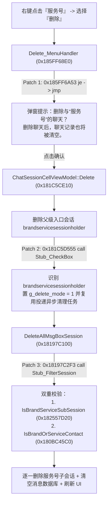

# WeChat-ServiceAccount-Purge (PC 微信“服务号”一键彻底清空补丁)

> **让 PC 微信右键“服务号 -> 删除”真正清空所有服务号子会话与历史聊天记录，不再尸变复活。**


-yellow)


---

## 😫 原版痛点

在 PC 微信 4.x（Qt 架构，`Weixin.dll`）中，**“服务号”**（`brandservicesessionholder`）是一个折叠了成百上千个服务通知/公众号的聚合盒子：
1. 当你在主界面右键点击 **“服务号 -> 删除”** 时，微信仅弹窗提示 `删除与“服务号”的聊天？`（故意隐藏了 `删除聊天后，聊天记录也将被清空。`）。
2. 点击确认后，微信底层仅删除了 `"brandservicesessionholder"` 这一行外层入口，**盒子里成百上千条服务号子会话及历史消息记录完全没有被删除**。
3. 一旦有任何一个服务号发来新消息，“服务号”盒子就会再次出现，点进去会发现**几年前的所有历史服务号和消息全部原封不动地躺在里面**，只能点进去一个个手动右键删除，极其繁琐。

---

## ✨ 补丁效果

本工具通过逆向分析 `Weixin.dll` 的会话管理与删除流水线，仅用 **3 处原生指令级微补丁（无需注入第三方 DLL，零外部依赖）** 实现最符合直觉的原生体验：

| 行为对比 | 原版 PC 微信 | 打补丁后 |
| :--- | :--- | :--- |
| **右键“服务号 -> 删除”弹窗文案** | `删除与“服务号”的聊天？`（副标题为空） | `删除与“服务号”的聊天？`<br>`删除聊天后，聊天记录也将被清空。`（与个人聊天完全一致） |
| **点击红色“删除”确认后** | 仅隐藏外层入口行，保留所有子会话与消息 | **移除外层入口 + 自动遍历清空所有服务号子会话及全部历史聊天记录** |
| **新服务号消息到达时** | 所有旧服务号和历史消息全部复活出现 | 仅显示新到达的那一条服务号，旧记录彻底清空 |
| **其他会话（个人/群聊/订阅号）** | 正常 | **100% 保持原样，双重校验绝不误伤** |

---

## 🚀 快速使用

本工具仅使用 Python 标准库（`ctypes`、`struct`），**无需安装任何第三方依赖**。支持 **进程内存热补丁（推荐，无需重启微信、不改磁盘文件、不破坏数字签名）** 和 **磁盘 DLL 持久化补丁** 两种模式。

### 方式一：进程内存热补丁（即开即用，零磁盘改动）

保持微信处于运行状态，直接双击运行 `apply_live_patch.bat`，或在终端执行：

```bash
# 查看当前运行进程与磁盘文件的补丁状态
python wx_service_delete_patch.py status

# 对当前运行中的 Weixin.exe 注入内存热补丁（立即生效，无需重启微信）
python wx_service_delete_patch.py apply

# 一键还原当前运行中的 Weixin.exe 为原版逻辑
python wx_service_delete_patch.py restore
```

### 方式二：磁盘文件持久化补丁（重启微信依然生效）

如需持久化写入 `Weixin.dll`（工具会自动在同一目录下创建 `Weixin.dll.bak` 备份），请先退出微信，并以**管理员权限**运行终端：

```bash
# 备份 Weixin.dll.bak 并写入持久化补丁
python wx_service_delete_patch.py file-apply

# 将磁盘 Weixin.dll 还原为原版状态
python wx_service_delete_patch.py file-restore
```

---

## 🔍 逆向原理简析

详细逆向过程与汇编级分析请参阅 [docs/REVERSE_ANALYSIS.md](docs/REVERSE_ANALYSIS.md)。



1. **为什么原版弹窗没有“聊天记录也将被清空”提示？**
   在 `Delete_MenuHandler` (`VA 0x185FF68E0`) 中，`0x185FF6A4A` 调用了 `VM::IsBrandServiceSessionHolder` (`0x181C59130`)，当返回 `true` 时故意将弹窗副标题置为空字符串 `""`。将 `0x185FF6A53` 的 `74 16` (`je`) 改为 `EB 16` (`jmp`) 即可恢复原生提示。
2. **为什么原版确认删除后不删服务号子会话？**
   在 `ChatSessionCellViewModel::Delete` (`VA 0x181C5CE10`) 末尾（`0x181C5D3EE..0x181C5D64C`），微信依次检查被删会话是否为微信客服盒子（调 `DeleteAllOpenIMKefuSession`）、小程序客服盒子（调 `DeleteAllWaAppKefuSession`）、折叠群聊盒子（调 `DeleteAllMsgBoxSession`），**唯独漏掉了对服务号盒子 `"brandservicesessionholder"` 的级联清理调用**。
3. **如何安全、无副作用地级联清空所有服务号子会话？**
   利用 `.text` 节尾部的对齐填充空隙（`RVA 0x76F9F50..0x76FA000`）放入共 86 字节的两个微型转发跳板（`Stub_CheckBox` 与 `Stub_FilterSession`），在删除 `"brandservicesessionholder"` 时复用原生的 `DeleteAllMsgBoxSession` 异步清理任务，并使用微信初始化服务号盒子时的同源判定函数 `IsBrandServiceSubSession` (`*(uint32_t*)(session + 400) == 1`) + `IsBrandOrServiceContact` (`gh_` 公众号属性) 进行双重过滤，逐一删除子会话及全部消息记录。

---

## 📁 目录结构

```text
.
├── README.md                    # 项目说明文档
├── LICENSE                      # MIT 开源许可证
├── wx_service_delete_patch.py   # 核心补丁工具（支持热补丁与持久化补丁）
├── apply_live_patch.bat         # Windows 双击一键注入内存热补丁脚本
└── docs/
    └── REVERSE_ANALYSIS.md      # 完整逆向分析报告、RVA 地址表与机器码详解
```

---

## ⚠️ 免责声明

1. 本项目仅供逆向工程技术研究、学习与个人客户端操作体验优化使用，严禁用于任何非法用途。
2. 执行清空操作后，服务号内的历史消息记录将被真实清空且不可恢复，请确认无需保留服务号旧账单/通知后再执行删除。
